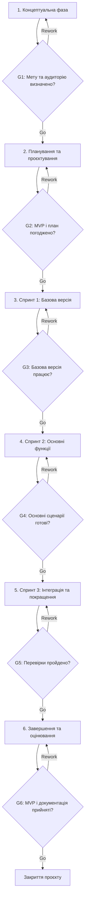

# Лабораторна робота №3. Побудова життєвого циклу проєкту StudentSwap

## 1. Обрана модель життєвого циклу

**Проєкт:** StudentSwap — платформа для обміну навчальними матеріалами та корисними ресурсами між студентами.

**Обрана модель:** гібридна модель: передбачуване планування на початку та адаптивна розробка короткими ітераціями за Scrum.

**Тип за сучасною класифікацією:** гібридна (Predictive + Adaptive/Agile).

На початку проєкту потрібно визначити його мету, основні вимоги, обсяг і критерії успіху, тому доцільно використати елементи передбачуваної моделі. Водночас під час розробки платформи вимоги до інтерфейсу та функцій можуть уточнюватися після отримання відгуків користувачів. Scrum дає змогу розробляти продукт частинами, перевіряти результат наприкінці кожного спринту та своєчасно змінювати пріоритети. Такий підхід підходить для навчального IT-проєкту з обмеженими ресурсами та можливістю поступового вдосконалення.

## 2. Фази життєвого циклу

Планова тривалість проєкту — **10 тижнів**. Тривалість є попередньою і може коригуватися після перевірки обсягу робіт.

| № | Назва фази | Мета фази | Тривалість (тижнів) | Ключові роботи | Deliverables (проміжні результати) | Відповідальний |
|---|---|---|---:|---|---|---|
| 1 | Концептуальна фаза | Визначити проблему, цільову аудиторію та цінність StudentSwap | 1 | Опис проблеми; визначення користувачів; формування цілей і меж проєкту; попередній аналіз ризиків | Project brief; опис мети й аудиторії; попередній перелік вимог | Керівник проєкту |
| 2 | Планування та проєктування | Узгодити вимоги, пріоритети й план реалізації | 2 | Створення Product Backlog; визначення MVP; планування спринтів; проєктування структури даних та інтерфейсу; розподіл ролей | Product Backlog; план спринтів; схема даних; прототип інтерфейсу | Керівник проєкту та аналітик/дизайнер |
| 3 | Спринт 1 — базова версія | Підготувати основу платформи | 2 | Налаштування репозиторію та середовища; створення базової структури; реалізація основних сторінок і навігації | Початкова версія застосунку; структура проєкту; демонстрація базового інтерфейсу | Розробник |
| 4 | Спринт 2 — основні функції | Реалізувати основні сценарії користувача | 2 | Реалізація профілю користувача; додавання та перегляд навчальних матеріалів; пошук або фільтрація; перевірка основних сценаріїв | Робочі основні функції; оновлений Product Backlog; результати перевірки | Розробник і тестувальник |
| 5 | Спринт 3 — інтеграція та покращення | Об’єднати функції та виправити виявлені проблеми | 2 | Інтеграційна перевірка; виправлення помилок; покращення зручності; збір відгуків і внесення пріоритетних змін | Інтегрована версія; список виправлень; результати тестування | Розробник і тестувальник |
| 6 | Завершення та оцінювання | Перевірити готовність і підготувати проєкт до демонстрації | 1 | Фінальне тестування; перевірка критеріїв приймання; підготовка README та демонстрації; підбиття підсумків | Фінальна версія MVP; документація; звіт про тестування; підсумки проєкту | Керівник проєкту та вся команда |

## 3. Ворота між фазами (Phase Gates)

На кожних воротах команда перевіряє критерії виходу з поточної фази. **Go** означає перехід далі, **Rework** — доопрацювання, **Kill** — припинення проєкту, якщо його цінність або здійсненність більше не підтверджується.

| Ворота | Між фазами | Критерії переходу | Можливі рішення |
|---|---|---|---|
| G1 | Концептуальна → Планування та проєктування | Проблема й цільова аудиторія визначені; мета проєкту зрозуміла; ідею можна реалізувати наявними ресурсами | Go / Rework / Kill |
| G2 | Планування та проєктування → Спринт 1 | Визначено MVP; сформовано пріоритетний Product Backlog; погоджено базову структуру та план робіт | Go / Rework / Kill |
| G3 | Спринт 1 → Спринт 2 | Застосунок запускається; базова структура й навігація працюють; основні технічні блокери відсутні | Go / Rework / Kill |
| G4 | Спринт 2 → Спринт 3 | Основні сценарії користувача реалізовані; критичні помилки відсутні або задокументовані; є версія для інтеграційної перевірки | Go / Rework / Kill |
| G5 | Спринт 3 → Завершення | Функції інтегровані; основні перевірки пройдено; критичні дефекти виправлено; отримані відгуки враховано або внесено до списку відомих обмежень | Go / Rework / Kill |
| G6 | Завершення → Закриття проєкту | MVP відповідає погодженим критеріям; README і результати тестування підготовлені; проведено демонстрацію та підсумковий огляд | Go / Rework / Kill |

## 4. Візуалізація життєвого циклу

## 5. Обґрунтування вибору моделі

Під час вибору моделі враховано, що StudentSwap є навчальним IT-проєктом, який має обмежений час і ресурси та орієнтований на потреби студентів. Частину вимог можна визначити заздалегідь: мету платформи, основні категорії користувачів і базові функції. Водночас деталі інтерфейсу та пріоритети можуть змінюватися після демонстрації проміжних версій.

Розглядалися каскадна модель Waterfall, інкрементна модель і Scrum. Waterfall відхилено як основну модель, оскільки повернення до вже завершених етапів може бути незручним у разі зміни вимог. Чиста інкрементна модель добре підходить для поступового додавання функцій, але сама по собі не визначає настільки чітко регулярні зустрічі та перегляд пріоритетів, як Scrum.

Перевага гібридної моделі полягає в поєднанні початкового планування з гнучкістю під час реалізації. Ворота між фазами дають змогу перевіряти готовність результатів, а короткі спринти — регулярно отримувати працездатні версії та виправляти проблеми до завершення всього проєкту.

Основні ризики — розширення обсягу робіт, нестача часу, помилки інтеграції та нерівномірний розподіл завдань. Для їх зменшення команда визначає MVP, пріоритезує Product Backlog, перевіряє результат кожного спринту та фіксує відповідальних за завдання. Якщо часу бракує, команда спочатку завершує найважливіші функції, а другорядні переносить до майбутніх покращень.

## 6. Висновок

Для StudentSwap обрано гібридну модель життєвого циклу з початковим плануванням і подальшою адаптивною розробкою за Scrum. Визначено шість фаз, контрольні ворота, критерії переходу та проміжні результати. Такий підхід допомагає контролювати виконання робіт і водночас адаптувати продукт до відгуків користувачів.
